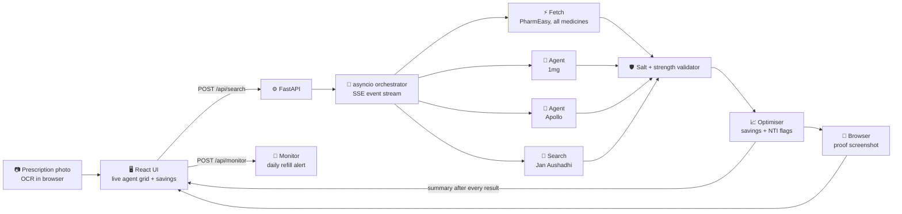

<div align="center">

# 💊 RxRadar

### Same medicine. Up to 88% cheaper. Found and proven by live web agents.


**Swim with TinyFish · Presidency University · 30 Oct 2026 · Team FuncLexa**

</div>

---

<div align="center">

## ₹15.88 → ₹1.88 per tablet

**The same diabetes medicine, at India's government Jan Aushadhi generic stores**

**₹9,363 / year** saved online alone for one patient on 3 chronic medicines · **₹10** of TinyFish credit per search

</div>

---

## 🩺 The problem

Indian families refill chronic medicines every month (diabetes, cholesterol, thyroid) and quietly overpay. There are three hidden price gaps:

| Gap | Real example (live runs, Bengaluru, 29–30 Oct 2026) |
|---|---|
| ⚖️ **Same molecule, cheaper brand** | Jalra M 50/500 **₹15.88**/tab → Somglip M 50/500 **₹6.59**/tab (−58%) |
| 📱 **Same brand, different app** | Jalra M: PharmEasy **₹15.88** vs Apollo **₹21.73** (+37%) |
| 🏛️ **Government generic** | Vildagliptin + Metformin 50/500 at Jan Aushadhi: **₹1.88**/tab (−88%) |

No pharmacy has a public price API, and every app shows only its own catalogue. So nobody compares, and everybody overpays.

> **A price tracker compares numbers. RxRadar compares molecules:** the same salt at the same strength, or it's rejected.

---

## ✨ How it works

1. **📷 Scan a prescription**: OCR runs **in the browser** (Tesseract.js) and fills in the medicines. Or pick from presets
2. **⚡ Instant first answer**: TinyFish Fetch prices every medicine on PharmEasy in seconds
3. **🤖 Live browser agents**: TinyFish Agents search 1mg and Apollo while you **watch them browse**
4. **🛡️ Salt validator**: wrong strengths, combos and unknown brands are **rejected visibly**
5. **🏛️ Government generic**: TinyFish Search finds the Jan Aushadhi price for each salt
6. **📸 Proof, not claims**: TinyFish Browser screenshots the real pharmacy page with the cheapest option highlighted
7. **🔔 Refill watch**: TinyFish Monitor checks the price daily

---

## 🐟 All 5 TinyFish tools, one job each

| | Tool | Job in RxRadar |
|:-:|---|---|
| ⚡ | **Fetch** | PharmEasy is server-rendered, so we read it as markdown. Up to 5 query variants per medicine in parallel, free and fast |
| 🤖 | **Agent** | 1mg and Apollo render with JavaScript, popups and loaders, so we use goal-driven browser agents with stealth mode, an India proxy, `output_schema` and a **live `streaming_url` embedded in the UI** |
| 🔎 | **Search** | Finds the Jan Aushadhi generic price per salt. Trusted Jan Aushadhi/PMBI domains only, validated by the salt checker |
| 📸 | **Browser** | A remote Chrome driven over CDP with Playwright, with **no AI guessing**: open the real page, highlight the cheapest product, screenshot it as proof |
| 🔔 | **Monitor** | Daily refill price alert on the chosen medicine's page |

> **Fetch for speed, Agent for messy sites, Search for the government generic, Browser for proof, Monitor for refills.**

---

## 🏗️ Architecture



> [!TIP]
> **Built for latency.** Agents take 1–2 minutes, so they start first, Fetch and Search run alongside them, and a fresh `summary` is streamed after **every** result. The first savings number lands in seconds.

> [!NOTE]
> **Replay mode.** Every live run is event-sourced to disk with timestamps and can be replayed exactly, with **zero TinyFish calls**. Summaries are recomputed on replay with the latest optimiser.

---

## 🛡️ Safe by design

| | Rule |
|:-:|---|
| ✅ | **Same salt, same strength only.** Combo markers (CV, EZ, TG, F, A, MF, AMH…) and wrong strengths are rejected and shown struck through |
| 🚫 | **Unknown brands are rejected, never guessed** |
| ⚠️ | **Narrow-therapeutic-index drugs** (e.g. levothyroxine) are flagged and **never switched** |
| 💯 | **Conservative savings.** "Your price" is the *cheapest* place to buy your own brand. Jan Aushadhi is shown separately and not added to totals |
| 🛒 | **Never auto-purchases.** Public pages only, no logins. Every swap says to confirm with your pharmacist |

---

## 🔧 Engineering challenges we solved

| Problem we hit live | Fix |
|---|---|
| Agents read pages **before prices loaded** and returned empty results, once a **hallucinated product** ("Jalra M 15mg") | Goals now say *wait for rendered prices, report only what you see*; the validator rejected the fake product |
| PharmEasy search is inconsistent ("Novastat 10" doesn't return Novastat 10mg) | Up to 5 query variants per medicine, merged and de-duplicated |
| 18 parallel fetches **all timed out** | Semaphore (max 8 in flight) + 12 s per-URL timeout: 3 medicines priced in ~6–20 s |
| A fetch occasionally **stalled forever** | Hard timeouts + retry at every layer; one slow source never freezes the stream |
| Account allows **2 concurrent browser agents** | Agents target the hero medicine; Fetch covers every medicine |
| Playwright can't spawn under uvicorn's Windows event loop | Browser proofs run in a dedicated thread with its own Proactor loop |
| UI sent "Vildagliptin + Metformin", "1Gm" | Canonical salt/strength normalisation (incl. g → mg) at the API boundary |

**10 automated tests**, including the optimiser checked against a **saved real live run**.

---

## 📈 Coverage & cost

- **9 chronic medicines** with presets: vildagliptin + metformin, sitagliptin + metformin, glimepiride, rosuvastatin, atorvastatin, telmisartan, amlodipine, clopidogrel, levothyroxine
- **Cost:** Fetch and Search are free. A full search costs **~₹10** of TinyFish credit (agent steps + browser minutes), reported per search in the UI

---

<details>
<summary><b>🚀 Run it locally</b></summary>

```bash
# Backend
cd backend
python -m venv .venv
.venv\Scripts\activate
python -m pip install -r requirements.txt
copy .env.example .env        # add your TINYFISH_API_KEY
uvicorn app.main:app --reload --port 8000

# Frontend
cd web
npm install
npm run dev
```

Full API spec: [`rxradar_api_contract.md`](rxradar_api_contract.md)

</details>

---

## 👥 Team FuncLexa

| | Member | Built |
|:-:|---|---|
| 🧠 | **Mohammad Adnan Shakil** | Backend: TinyFish orchestration (all 5 tools), salt validation, optimiser, replay, proof screenshots |
| 🎨 | **Sultan** | Frontend: live agent grid, savings UI, comparison matrix, in-browser OCR, integration |

<div align="center">

*Built in one day at Presidency University, Bengaluru 🇮🇳*

</div>
