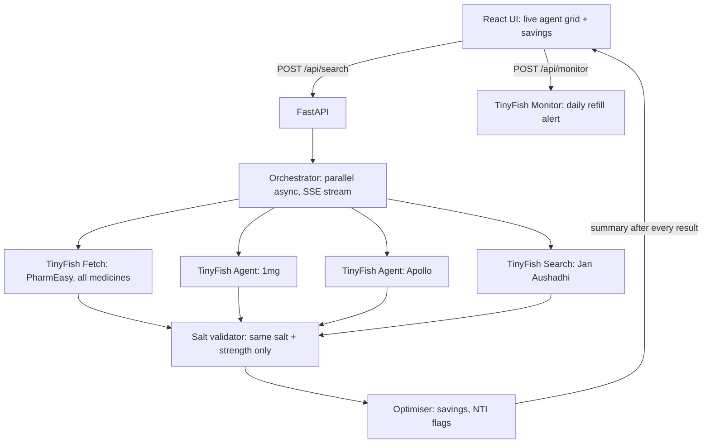

# RxRadar

**Same medicine. Up to 88% cheaper. Found by live web agents.**

Built for *Swim with TinyFish* (Presidency University, 30 Oct 2026) by **Team FuncLexa**.

## The problem

Indian families refill chronic medicines (diabetes, cholesterol, thyroid) every month and overpay because:

- The same salt at the same strength is sold under dozens of brands at very different prices.
- The **same brand** costs different amounts on different apps.
- No pharmacy offers a public price API, and comparing 5 medicines across 4 apps by hand means 20 searches every month.

## Real numbers (live TinyFish runs, Bengaluru, 29–30 Oct 2026)

| Finding | Data |
|---|---|
| Same brand, different app | Jalra M 50/500: ₹15.88/tab on PharmEasy vs ₹21.73 on Apollo (+37%) |
| Same salt, same strength, same app | Jalra M ₹15.88 vs Somglip M ₹6.59/tab (−58%) |
| Government generic | Vildagliptin + Metformin 50/500 at Jan Aushadhi: ₹1.88/tab (−88%) |
| Statin | Novastat 10: ₹18.61 → Roseday 10: ₹11.18 online, ₹1.13 at Jan Aushadhi |
| Demo patient (3 medicines) | **₹9,363.60/year** saved online, before the Jan Aushadhi option |

## How TinyFish powers it

TinyFish isn't a feature of RxRadar. It's the engine: **4 TinyFish APIs, each doing a real job.**

| TinyFish API | What it does in RxRadar |
|---|---|
| **Agent** (browser automation, stealth + India proxy, live stream) | Searches 1mg and Apollo like a human, closes popups, waits for results, returns structured prices |
| **Fetch** | Prices every medicine on PharmEasy in seconds, many search URLs in parallel |
| **Search** | Finds the Jan Aushadhi government generic price for each salt |
| **Monitor** | Daily refill price alert on the chosen medicine |

## Architecture



**Latency design:** PharmEasy answers in seconds, so the first savings number appears almost immediately. The browser agents then refine it live. A `summary` event is sent after every result, never only at the end.

**Replay mode:** every live run is saved and can be replayed with the original timing and zero TinyFish calls, as a stage-safe fallback.

## Safety by design

- **Same salt, same strength only.** Combos (CV, EZ, TG, F, A/Aspirin) and wrong strengths are rejected visibly.
- **Unknown brands are rejected, never guessed.**
- **Narrow-therapeutic-index drugs** (e.g. levothyroxine) are flagged and never switched.
- RxRadar **never auto-purchases**. Every swap says to confirm with your pharmacist.

## Cost

PharmEasy Fetch and Search are free. Only browser agents are billed (per step and per browser-minute). Each search reports its own TinyFish cost in the final summary.

## Run it

```bash
# backend
cd backend
python -m venv .venv && .venv\Scripts\activate
python -m pip install -r requirements.txt
copy .env.example .env   # add TINYFISH_API_KEY
uvicorn app.main:app --reload --port 8000

# frontend
cd web
npm install && npm run dev
```

API contract: [`rxradar_api_contract.md`](rxradar_api_contract.md)

## Team FuncLexa

- **Mohammad Adnan Shakil**: agents, orchestration, validation, optimiser (backend)
- **Sultan**: live agent grid, savings UI, integration (frontend)
