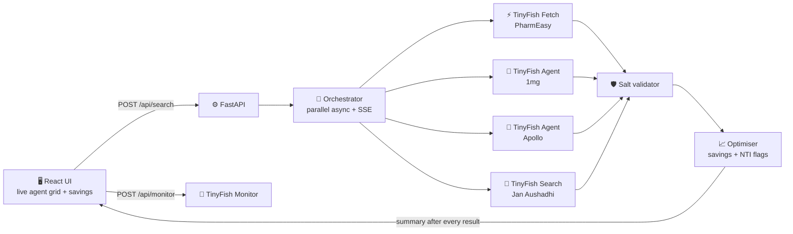

<div align="center">

# 💊 RxRadar

### Same medicine. Up to 88% cheaper. Found by live web agents.


**Swim with TinyFish · Presidency University · 30 Oct 2026 · Team FuncLexa**

</div>

---

<div align="center">

## ₹9,363 / year

**saved for one patient on 3 chronic medicines, found by live TinyFish agents in under 3 minutes**

*…and up to 94% cheaper again at Jan Aushadhi government stores*

</div>

---

## 🩺 The problem

Indian families refill chronic medicines every month (diabetes, cholesterol, thyroid) and quietly overpay.

- 🔁 **The same salt at the same strength** is sold under dozens of brands at very different prices
- 📱 **The same brand** costs different amounts on different pharmacy apps
- 🔒 **No pharmacy has a public price API.** Comparing 5 medicines across 4 apps by hand means **20 searches, every month**

So nobody compares, and everybody overpays.

---

## 📊 What our agents found (live runs, Bengaluru, 29–30 Oct 2026)

| | Finding | Price per tablet |
|:-:|---|---|
| 🏷️ | **Same brand, different app:** Jalra M 50/500 | PharmEasy **₹15.88** vs Apollo **₹21.73** · *+37%* |
| ⚖️ | **Same salt, same app:** Jalra M vs Somglip M | **₹15.88 → ₹6.59** · *−58%* |
| 🏛️ | **Government generic:** Vildagliptin + Metformin 50/500 | Jan Aushadhi **₹1.88** · *−88%* |
| 💙 | **Statin:** Novastat 10 → Roseday 10 | **₹18.61 → ₹11.18** online · **₹1.13** Jan Aushadhi |

---

## 🐟 TinyFish is the engine, not a feature

RxRadar uses **4 TinyFish APIs**, each doing a real job:

| | TinyFish API | What it does |
|:-:|---|---|
| 🤖 | **Agent** | Browses 1mg and Apollo like a human: stealth mode, India proxy, closes popups, waits for results, returns structured prices, **streams the live browser** |
| ⚡ | **Fetch** | Prices every medicine on PharmEasy in seconds, many searches in parallel |
| 🔎 | **Search** | Finds the **Jan Aushadhi** government generic price for each salt |
| 🔔 | **Monitor** | Daily refill price alert on the medicine you choose |

---

## 🏗️ Architecture



> [!TIP]
> **Built for latency.** PharmEasy answers in seconds, so the first savings number is on screen almost immediately. The browser agents then **refine it live**: a fresh summary goes out after *every* result, never only at the end.

> [!NOTE]
> **Replay mode.** Every live run is saved and can be replayed with the original timing and **zero TinyFish calls**. It's a stage-safe fallback that behaves identically in the UI.

---

## 🛡️ Safe by design

| | Rule |
|:-:|---|
| ✅ | **Same salt, same strength only.** Combos (CV, EZ, TG, F, Aspirin) and wrong strengths are rejected, visibly |
| 🚫 | **Unknown brands are rejected, never guessed** |
| ⚠️ | **Narrow-therapeutic-index drugs** (e.g. levothyroxine) are flagged and **never switched** |
| 🛒 | **Never auto-purchases.** Every swap says to confirm with your pharmacist |

---

## 💸 What a search costs

PharmEasy **Fetch** and **Search** are free. Only browser agents are billed, per step and per browser-minute, and **every search reports its own TinyFish cost** in the final summary. That's a few rupees spent to save thousands a year.

---

<details>
<summary><b>🚀 Run it locally</b></summary>

```bash
# Backend
cd backend
python -m venv .venv
.venv\Scripts\activate
python -m pip install -r requirements.txt
copy .env.example .env        # add your TINYFISH_API_KEY
uvicorn app.main:app --reload --port 8000

# Frontend
cd web
npm install
npm run dev
```

Full API spec: [`rxradar_api_contract.md`](rxradar_api_contract.md)

</details>

---

## 👥 Team FuncLexa

| | Member | Built |
|:-:|---|---|
| 🧠 | **Mohammad Adnan Shakil** | TinyFish agents, orchestration, salt validation, optimiser, replay |
| 🎨 | **Sultan** | Live agent grid, savings UI, frontend integration |

<div align="center">

*Made in 6 hours at Presidency University, Bengaluru 🇮🇳*

</div>
